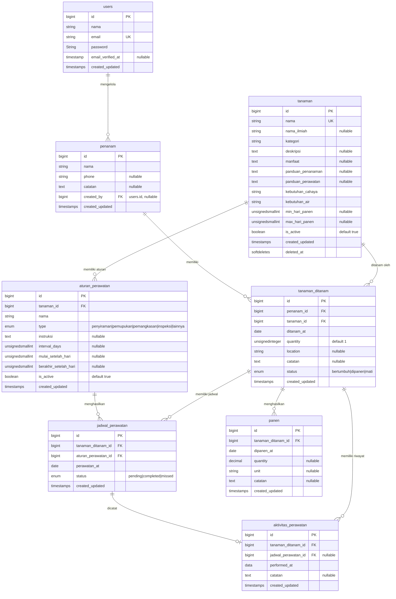

# SPESIFIKASI PROYEK — "KebunTOGA"

**Mata Kuliah:** Inovasi Sosial (3 SKS, Semester 5)
**Lokasi:** Kecamatan Balikpapan Timur, Kelurahan Lamaru, RT 19
**Stack wajib:** Laravel 12, MySQL/MariaDB
**Dokumen ini adalah kontrak proyek.** Skema database dan kontrak API bersifat WAJIB dan tidak boleh diubah tanpa persetujuan bersama.

---

## 1. Latar Belakang & Sasaran

### 1.1 Nama Produk
> Platform digital yang membantu pengguna menanam, merawat, dan memantau Tanaman Obat Keluarga (TOGA) melalui panduan perawatan, jadwal penyiraman, pencatatan perkembangan tanaman, serta estimasi waktu tanaman dapat dipanen atau dimanfaatkan.

### 1.2 Latar Belakang
Tanaman Obat Keluarga (TOGA) dapat ditanam di lingkungan rumah dan dimanfaatkan sebagai salah satu sumber tanaman yang memiliki kegunaan kesehatan maupun kebutuhan rumah tangga. Namun, keberhasilan menanam TOGA tidak hanya bergantung pada proses penanaman awal, tetapi juga pada perawatan yang dilakukan secara konsisten.

Bagi pengguna yang belum memiliki banyak pengalaman bercocok tanam, beberapa hal dapat menjadi kendala, seperti:

- tidak mengetahui seberapa sering tanaman perlu disiram;
- tidak mengetahui kebutuhan perawatan setiap jenis tanaman;
- lupa melakukan penyiraman atau perawatan;
- tidak mengetahui tahapan pertumbuhan tanaman;
- kesulitan memperkirakan kapan tanaman dapat dipanen atau mulai dimanfaatkan;
- tidak memiliki catatan mengenai perkembangan tanaman yang sedang ditanam.

Masalah tersebut menjadi semakin relevan ketika setiap tanaman memiliki kebutuhan yang berbeda. Jadwal perawatan yang sama tidak selalu sesuai untuk semua tanaman.

Kebun TOGA dirancang untuk mengubah informasi perawatan tanaman menjadi panduan yang lebih praktis dan terpersonalisasi berdasarkan tanaman yang dimiliki pengguna.

### 1.3 Problem Statement
> Pengguna yang ingin menanam TOGA membutuhkan cara yang sederhana untuk mengetahui apa yang harus dilakukan terhadap tanaman mereka, kapan harus melakukannya, dan kapan tanaman tersebut diperkirakan dapat dimanfaatkan.

| No. | Problem | Impact |
| --- | ------- | ------ |
| 1 | Pengguna tidak mengetahui kebutuhan perawatan masing-masing tanaman | Perawatan dapat dilakukan terlalu sering atau terlalu jarang |
| 2 | Pengguna dapat lupa melakukan penyiraman | Tanaman berisiko tidak mendapatkan perawatan secara konsisten |
| 3 | Informasi perawatan tersebar di berbagai sumber | Pengguna harus mencari informasi sendiri |
| 4 | Pengguna sulit mengetahui perkembangan tanaman | Sulit mengetahui apakah tanaman berada pada tahap pertumbuhan yang sesuai |
| 5 | Pengguna tidak mengetahui estimasi waktu panen/pemanfaatan | Ekspektasi terhadap hasil tanaman menjadi tidak jelas |
| 6 | Tidak ada pencatatan tanaman yang dimiliki | Pengguna sulit memantau beberapa tanaman sekaligus |

### Sasaran Pengguna:
#### Primary Users
**Ibu rumah tangga atau pengguna rumahan yang ingin menanam TOGA tetapi membutuhkan bantuan dalam melakukan perawatan dan pemantauan tanaman.**

Karakteristik yang kita targetkan:
- memiliki atau ingin memiliki tanaman TOGA di rumah;
- tidak harus memiliki pengetahuan botani yang mendalam;
- membutuhkan instruksi yang sederhana;
- memiliki beberapa tanaman dengan kebutuhan berbeda;
- membutuhkan pengingat agar perawatan lebih konsisten;
- lebih membutuhkan informasi praktis daripada informasi teknis yang terlalu kompleks.

#### Secondary Users
Kita dapat mempertimbangkan pengguna lain seperti:
- pemula yang ingin belajar menanam TOGA;
- keluarga yang memiliki kebun rumah;
- komunitas tanaman;
- pengguna yang sudah memiliki pengalaman bercocok tanam tetapi ingin melakukan pencatatan digital.

Tapi tetap Primary Users untuk MVP nya

### 1.5 Tujuan Produk
#### Tujuan Utama
Membantu pengguna mengelola perawatan tanaman TOGA secara lebih teratur dan mudah dipahami.

#### Tujuan Spesifik
Kebun TOGA diharapkan dapat membantu pengguna:
1. menemukan informasi tanaman TOGA;
2. memahami kebutuhan dasar setiap tanaman;
3. mengetahui kapan tanaman perlu disiram;
4. mengetahui aktivitas perawatan yang perlu dilakukan;
5. mencatat tanaman yang sedang dimiliki;
6. memantau perkembangan tanaman;
7. memperoleh estimasi waktu panen atau pemanfaatan;
8. mengurangi ketergantungan pada pencarian informasi manual dari berbagai sumber.

### 1.6 Value Proposition
Nilai utama produk dapat dirumuskan menjadi:
> **"Satu tempat untuk mengetahui apa yang harus dilakukan terhadap tanaman TOGA, kapan harus melakukannya, dan kapan hasilnya dapat dimanfaatkan."**

Ada tiga konsep utama:
```
WHAT?
Apa yang harus dilakukan?
        │
        ▼
HOW?
Bagaimana cara melakukannya?
        │
        ▼
WHEN?
Kapan harus dilakukan / kapan hasilnya tersedia?
```

Katalog hanya menjawab:
> "Apa itu tanaman X?"

Sedangkan Kebun TOGA harus menjawab:
> "Tanaman saya sekarang perlu melakukan apa?"

### 1.7 Core User Job
Kalau kita menggunakan perspektif Jobs-to-be-Done, kebutuhan pengguna dapat diringkas menjadi:
> **"Ketika saya menanam tanaman obat di rumah, saya ingin mengetahui perawatan yang harus saya lakukan dan waktunya, sehingga saya dapat menjaga tanaman tetap terawat dan mengetahui kapan tanaman tersebut dapat dimanfaatkan."**

Dari sini muncul tiga kebutuhan inti:
1. **Know**
Pengguna perlu mengetahui:

- tanaman apa yang dimiliki;
- kebutuhan tanaman;
- kondisi/tahap pertumbuhan;
- estimasi waktu panen.

2. **Do**
Pengguna perlu melakukan:

- penyiraman;
- pemupukan;
- pemangkasan;
- aktivitas perawatan lainnya.

3. **Track**
Pengguna perlu dapat:

- mencatat aktivitas;
- melihat riwayat;
- memantau perkembangan;
- mengetahui jadwal berikutnya.

### 1.8 Konsep Produk
**Knowledge Base (Katalog Tanaman)** 

Berisi informasi umum yang dikelola sistem:

- jenis tanaman;
- karakteristik tanaman;
- kebutuhan air;
- kebutuhan cahaya;
- media tanam;
- panduan perawatan;
- tahapan pertumbuhan;
- estimasi waktu panen.

**Kebunku**

Berisi kondisi spesifik milik pengguna:

- tanaman yang sedang ditanam;
- tanggal mulai menanam;
- lokasi tanaman;
- jadwal penyiraman;
- aktivitas perawatan;
- perkembangan;
- estimasi panen.

Ini merupakan **pemisahan domain yang sangat penting**

### 1.9 Aturan Bisnis
1. Rule 01 — Tanaman memiliki informasi dasar
2. Rule 02 — Tanaman pengguna berbeda dari katalog tanaman
3. Rule 03 — Jenis tanaman sudah ditentukan dan ditunjukkan melalui katalog tanaman
4. Rule 04 — Jadwal bergantung pada tanaman
5. Rule 05 — Estimasi panen bukan tanggal absolut

### 1.10 Batasan Produk Awal
Untuk menjaga MVP tetap relistis nih, kita perlu membuat batasan.

Versi awal (Yang Akarasa buat) tidak harus:
- mendiagnosis penyakit tanaman menggunakan AI;
- menentukan kondisi tanah secara otomatis;
- menggunakan sensor IoT;
- menjamin keberhasilan tanaman;
- memberikan diagnosis kesehatan manusia;
- memberikan rekomendasi medis berdasarkan tanaman.

### 1.11 Indikator keberhasilan produk
| Indikator | Tujuan |
| --------- | ------ |
| Pengguna berhasil menambahkan tanaman | Mengukur keberhasilan onboarding |
| Pengguna mengetahui jadwal perawatan berikutnya | Mengukur fungsi utama |
| Pengguna mencatat aktivitas perawatan | Mengukur engagement |
| Pengguna dapat melihat estimasi panen | Mengukur usefulness |
| Pengguna kembali untuk memeriksa dashboard | Mengukur penggunaan berkelanjutan |

### 1.12 Product Principles
4 prinsip desain:

1. **Simple**; Pengguna tidak perlu memahami istilah botani untuk menggunakan aplikasi.

2. **Action-oriented**; Informasi harus berujung pada tindakan.

3. **Personalized**; Informasi umum tanaman harus diterjemahkan menjadi informasi yang relevan dengan tanaman milik pengguna.

4. **Honest about uncertainty**; Estimasi seperti waktu panen harus disajikan sebagai perkiraan, bukan kepastian.

> **catatan pernting** Core problem yang kita selesaikan bukan "memberikan informasi tentang TOGA", melainkan "membantu pengguna mengubah informasi tanaman menjadi tindakan perawatan yang tepat waktu."

---

## 2. Ruang Lingkup

### 2.1 Fitur Wajib

| # | Modul | Aktor | Deskripsi minimum |
|---|-------|-------|-------------------|
| F1 | Katalog Tanaman Toga | Pengunjung | a |
| F2 | Detail & Panduan Tanaman | Pengunjung | Setiap tanaman memiliki halaman detail; Berisi informasi dasar, informasi penanaman, informasi perawatan, informasi hasil. |
| F3 | Manajemen Penanaman | Pengunjung | mengubah informasi umum tanaman menjadi tanaman konkret milik seorang penanam; Pengunjung dapat menambahkan tanaman. |
| F4 | Dashboard Kebun | Penanam | penanam dapat melihat kondisi kebunnya. |
| F5 | Jadwal Perawatan | Penanam | menampilkan aktivitas yang perlu dilakukan. |
| F6 | Estimasi Hasil/Panen | Penanam | menghitung estimasi berdasarkan data tanaman, jadi bahan growth tracking.. |
| F7 | Admin Management | Admin | satu-satunya aktor yang memiliki authentication. |

### 2.2 Fitur tambahan

1. Foto perkembangan (unutk membuat growth journal)
2. Catatan Perawatan (penanam dapat menulis sesuatu)
3. Notifikasi
4. Rekomendasi Tanaman
5. Integrasi Cuaca (hell nah)
6. Pencacatan Panen (isinya: Tanggal panen, Jumlah hasil, Satuan,Catatan)


### 2.3 Di Luar Lingkup (JANGAN dikerjakan)
| Modul | Aktor |
|-------|-------|
| Login penanam | ❌ Tidak diperlukan |
| Registrasi penanam | ❌ Tidak diperlukan |
| E-commerce tanaman/obat | ❌ |
| Pembayaran | ❌ |
| Diagnosis penyakit berbasis AI | ❌ |
| IoT sensor tanaman & tanah | ❌ |
| Integrasi hardware penyiraman otomatis | ❌ |
| Konsultasi dokter penyakit manusia | ❌ |
| Rekomendasi medis dengan bahan TOGA | ❌ |
| Marketplace | ❌ |
| Community | ❌ |
| Weather API | ❌ |

> Proyek tetap fokus pada **Information + Scheduling + Tracking.**

### 2.4 Prioritas Fitur
#### P0 -- core/wajib
Harus ada agar aplikasi memenuhi tujuan utamanya.
> 
Katalog tanaman
 Detail tanaman
 Tambah tanaman
 Nama penanam
 Tanggal tanam
 Dashboard kebun
 Jadwal perawatan
 Filter berdasarkan penanam
 Estimasi panen
 Admin authentication
 CRUD tanaman
 CRUD penanam

#### P1 -- Enhancement
Sangat berguna tetapi aplikasi masih dapat berjalan tanpa fitur ini.
> 
 Care log
 Growth journal
 Foto perkembangan
 Pencatatan panen
 Notifikasi

### 2.5 Use Case Utama
#### US-01 — Melihat tanaman

> Sebagai pengunjung, saya ingin melihat daftar tanaman TOGA sehingga saya dapat mengetahui tanaman yang tersedia.

#### US-02 — Memahami tanaman

> Sebagai pengunjung, saya ingin melihat detail dan panduan suatu tanaman sehingga saya mengetahui cara menanam dan merawatnya.

#### US-03 — Mendaftarkan tanaman

> Sebagai penanam, saya ingin mencatat tanaman yang saya tanam beserta nama dan tanggal tanam sehingga sistem dapat membuat jadwal perawatan untuk tanaman tersebut.

#### US-04 — Melihat kebun

> Sebagai penanam, saya ingin melihat tanaman yang saya tanam berdasarkan nama saya sehingga saya dapat memantau kebun saya.

#### US-05 — Mengetahui jadwal

> Sebagai penanam, saya ingin melihat aktivitas perawatan yang harus dilakukan sehingga saya tidak lupa merawat tanaman.

#### US-06 — Menyelesaikan perawatan

> Sebagai penanam, saya ingin menandai aktivitas perawatan sebagai selesai sehingga sistem dapat mencatat aktivitas yang telah saya lakukan.

#### US-07 — Mengetahui estimasi panen

> Sebagai penanam, saya ingin melihat estimasi waktu tanaman dapat dipanen atau dimanfaatkan sehingga saya memiliki gambaran mengenai hasil tanaman saya.

#### US-08 — Administrasi tanaman

> Sebagai admin, saya ingin mengelola data tanaman sehingga informasi yang tersedia bagi penanam tetap dapat diperbarui.

#### US-09 — Administrasi penanam

> Sebagai admin, saya ingin mengelola data penanam sehingga data tanaman dapat dikaitkan dengan penanam yang tepat.

### 2.6 Kriteria keberhasilan MVP
Penambahan tanaman

#### Sistem harus:

- meminta nama penanam;
- meminta tanaman;
- meminta tanggal tanam;
- menyimpan data;
- menghasilkan jadwal berdasarkan data tanaman;
- menghitung estimasi berdasarkan tanggal tanam.

#### Jadwal
Sistem harus:

- menampilkan tanaman milik penanam;
- menampilkan aktivitas yang perlu dilakukan;
- membedakan jadwal yang sudah/belum selesai;
- memungkinkan penanam menandai aktivitas selesai.

#### Estimasi
Sistem harus:

- menggunakan tanggal tanam sebagai salah satu dasar perhitungan;
- menampilkan estimasi sebagai rentang/perkiraan;
- tidak menyatakan tanggal panen sebagai kepastian mutlak.

#### Admin
Sistem harus:

- mengharuskan authentication untuk area admin;
- mencegah guest mengakses halaman admin;
- menyediakan CRUD tanaman;
- menyediakan CRUD penanam.
---

## 3. Peran & Hak Akses

| Aktor | Authentication | Memiliki akun | Fungsi utama |
|------|:-----:|:-----:|:---------:|
| Pengunjung | No | No | Mengakses fitur publik dan mengelola data kebun melalui identitas penanam |
| Penanam | No | No | Mengelola/mengecek tanaman yang dikaitkan dengan namanya |
| Admin | Yes | Yes | Mengelola/mengecek tanaman yang dikaitkan dengan namanya |

**Catatan**
- Dalam implementasi, orang yang menggunakan website sebagai penanam tetap merupakan guest/non-authenticated user.

- Pengunjung dan Penanam bukan dua role database yang berbeda. "Penanam" adalah identitas data, bukan account.

---

## 4. Skema Database (WAJIB)

### 4.1 Diagram Relasi



### 4.2 Constraint & Index Wajib

| Tabel | Ketentuan |
|-------|-----------|
| `users` | `email` UNIQUE; `nim_nip` UNIQUE nullable; tidak ada `role` |
| `penanam` | FK `tanaman_tanaman.penanam_id` `restrictOnDelete`; nama tanaman: UNIQUE |
| `tanaman` | FK `tanaman_tanaman.tanaman_id`, `aturan_perawatan.tanaman_id` |
| `tanaman_ditanam` | FK `jadwal_perawatan.tanaman_ditanam_id` `aktivitas_perawatan.tanaman_ditanam_id` `panen.tanaman_ditanam_id` `cascadeOnDelete`; Index: `tanaman_tanaman(penanam_id)`, `tanaman_tanaman(tanaman_id)` |
| `aturan_perawatan` | FK `jadwal_perawatan.aturan_perawatan_id`; index: `aturan_perawatan(tanaman_id)` |
| `jadwal_perawatan` | UNIQUE(`tanaman_ditanam_id`, `aturan_perawatan_id`, `perawatan_at`); index: `jadwal_perawatan(tanaman_ditanam_id)`, `jadwal_perawatan(aturan_perawatan_id)`, `jadwal_perawatan(perawatan_at)` |
| `aktivitas_perawatan` | index: `aktivitas_perawatan(tanaman_ditanam_id)`, `aktivitas_perawatan(performed_at)` |
| `panen` | index: `panen(tanaman_ditanam_id)`, `panen(dipanen_at)` |

Semua migrasi **wajib reversible** (`down()` benar-benar mengembalikan keadaan). Dan sepertinya perlu diperbaiki mengenai banyak kode yang pakai **tanaman**

### 4.3 Relasi Eloquent yang Diharapkan

Nama method relasi ikut ditetapkan, karena dipakai di modul, di soal interview, dan di skrip pengujian.

```
User              : hasMany(Penanam::class, 'created_by')

Penanam           : belongsTo(User::class, 'created_by')
                    hasMany(TanamanDitanam::class)

Tanaman           : hasMany(TanamanDitanam::class)
                    asMany(AturanPerawatan::class)

TanamanDitanam   : belongsTo(Penanam::class)       belongsTo(Tanaman::class)
                    hasMany(JadwalPerawatan::class)    hasMany(AktivitasPerawatan::class)
                    hasMany(Panen::class)

AturanPerawatan  : belongsTo(Tanaman::class) hasMany(JadwalPerawatan::class)

JadwalPerawatan  : belongsTo(TanamanDitanam::class) belongsTo(AturanPerawatan::class)
                    hasOne(AktivitasPerawatan::class)

AktivitasPerawatan: belongsTo(TanamanDitanam::class) belongsTo(JadwalPerawatan::class)

Panen             : belongsTo(TanamanDitanam::class)
 
```

---

## 5. Kontrak API (WAJIB — dipakai mulai minggu 6)

Prefix `/api/v1`. Semua response dibungkus API Resource.

| Method | Endpoint | Keterangan |
|--------|----------|------------|
| GET | `/tanaman` | Daftar tanaman |
| GET | `/tanaman/{tanaman}` | Detail tanaman |
| GET | `/penanam` | Daftar penanam |
| POST | `/tanaman-tanaman` | Menambahkan tanaman |
| GET | `/penamans/{penanam}/garden` | Melihat kebun |
| GET | `/penamans/{penanam}/perawatan` | Melihat jadwal |
| GET | `/jadwal-perawatan/{perawatan}/complete` | Menyelesaikan perawatan |
| CRUD | `/admin/tanaman` | Kelola tanaman |
| CRUD | `/admin/penamans` | Kelola penanam |
| CRUD | `/admin/aturan-perawatan` | Kelola aturan perawatan |
| GET | `/admin/tanaman-tanaman` | Melihat seluruh tanaman |
| GET | `/admin/jadwal-perawatan` | Monitoring jadwal |

**Format response wajib:**

```json
// sukses (koleksi)
{
    "data": {
        "id": 1,
        "name": "Jahe"
    },
    "message": "Data tanaman berhasil diambil."
}

// sukses (tunggal)
{ "data": { ... } }

// untuk collection
{
    "data": [
        {
            "id": 1,
            "name": "Jahe"
        },
        {
            "id": 2,
            "name": "Kunyit"
        }
    ]
}

// error validasi — 422
{
    "message": "Data yang diberikan tidak valid.",
    "errors": {
        "tanaman_at": [
            "..."
        ]
    }
}

```


---

## 6. Jalur Frontend

| Ketentuan |
|-----------|
| **Blade + Livewire 3** karena: aplikasi cukup CRUD-oriented; interaksi utamanya berupa form, filter, dashboard, dan jadwal; tidak membutuhkan SPA kompleks;|

---

## 7. Definition of Done per Fitur

Sebuah fitur baru dianggap selesai jika **seluruhnya** terpenuhi:


1. Katalog tanaman TOGA
- [ ]  Data tanaman tampil sesuai spesifikasi dan data seeder.
- [ ]  Pengguna dapat melihat daftar tanaman.
- [ ]  Pengguna dapat mencari tanaman berdasarkan nama.
- [ ]  Filter kategori berjalan jika diterapkan.
- [ ]  Detail tanaman dapat dibuka berdasarkan ID/slug.
- [ ]  Data yang ditampilkan berasal dari database, bukan hardcode.
- [ ]  Tanaman yang berstatus is_active = false tidak tampil di halaman publik.
- [ ]  Tanaman yang di- [ ] soft- [ ] delete tidak tampil di halaman publik.
- [ ]  Jika tanaman tidak ditemukan, sistem menampilkan 404 yang sesuai.
- [ ]  Query database menggunakan relasi/Eloquent yang sesuai dan tidak menghasilkan query berlebihan yang tidak perlu

2. Detail dan panduan TOGA
- [ ]  Informasi dasar tanaman tampil dengan benar.
- [ ]  Panduan penanaman tersedia.
- [ ]  Panduan perawatan tersedia.
- [ ]  Kebutuhan cahaya dan air tampil.
- [ ]  Estimasi waktu panen ditampilkan sebagai rentang, bukan tanggal pasti.
- [ ]  Data nullable ditangani dengan baik jika informasi tertentu tidak tersedia.
- [ ]  Tidak ada informasi yang berasal dari hardcode apabila datanya seharusnya berasal dari plants.

3. Manajemen penanaman
- [ ]  Pengguna dapat menambahkan tanaman yang ditanam.
- [ ]  penanam_id, plant_id, dan planted_at wajib divalidasi.
- [ ]  quantity harus bernilai valid, minimal 1.
- [ ]  plant_id harus benar- [ ] benar merujuk ke tanaman yang tersedia.
- [ ]  Validasi dilakukan di server- [ ] side, bukan hanya frontend.
- [ ]  Data tersimpan ke planted_plants.
- [ ]  Tanaman yang ditambahkan muncul pada kebun penanam yang sesuai.
- [ ]  Tanggal penanaman digunakan sebagai dasar perhitungan jadwal dan estimasi panen.
- [ ]  Data yang tidak valid tidak dapat dimasukkan dengan manipulasi request langsung.

4. Dashboard Kebun
- [ ]  Pengguna dapat memilih/mencari penanam.
- [ ]  Tanaman milik penanam tersebut ditampilkan.
- [ ]  Tanaman milik penanam lain tidak tercampur.
- [ ]  Jadwal perawatan hari ini ditampilkan.
- [ ]  Tanaman yang mendekati estimasi panen ditampilkan.
- [ ]  Status tanaman (growing, harvested, dead) ditampilkan secara konsisten.
- [ ]  Dashboard menggunakan data database aktual.
- [ ]  Kondisi tanpa tanaman ditangani dengan empty state.

5. Jadwal perawatan
- [ ]  Jadwal dibuat berdasarkan care_rules tanaman.
- [ ]  Jadwal menggunakan tanggal penanaman sebagai dasar perhitungan.
- [ ]  Jenis perawatan tampil dengan benar.
- [ ]  Instruksi perawatan tampil sesuai aturan tanaman.
- [ ]  Status jadwal (pending, completed, missed) berjalan sesuai aturan.
- [ ]  Jadwal tidak dibuat dua kali untuk kombinasi tanaman + aturan + tanggal yang sama.
- [ ]  Jadwal tanaman yang sudah harvested atau dead tidak menghasilkan jadwal perawatan baru.
- [ ]  Pengguna dapat melihat jadwal berdasarkan tanggal.
- [ ]  Validasi dilakukan server- [ ] side.

6. Menandai perawatan selesai
- [ ]  Pengguna dapat menandai jadwal sebagai selesai.
- [ ]  Hanya jadwal yang valid yang dapat diselesaikan.
- [ ]  Status berubah dari pending menjadi completed.
- [ ]  Sistem mencatat aktivitas ke care_logs.
- [ ]  performed_at tercatat.
- [ ]  Pengguna tidak dapat menyelesaikan jadwal yang sudah completed secara berulang sehingga menghasilkan log duplikat.
- [ ]  Endpoint tidak dapat digunakan untuk memanipulasi jadwal milik penanam lain secara sembarangan.
- [ ]  Validasi dan pengecekan kepemilikan dilakukan di server- [ ] side.

7. Estimasi panen
- [ ]  Estimasi dihitung berdasarkan planted_at.
- [ ]  harvest_min_days digunakan untuk tanggal minimum.
- [ ]  harvest_max_days digunakan untuk tanggal maksimum.
- [ ]   Sistem menampilkan rentang tanggal, misalnya 10 Januari – 25 Januari.
- [ ]  Jika data estimasi tidak tersedia, sistem tidak membuat tanggal palsu.
- [ ]  Estimasi berubah otomatis jika planted_at berbeda.
- [ ]  Estimasi bukan dianggap sebagai tanggal panen pasti.

8. Pencatatan panen
- [ ]  Pengguna/admin dapat mencatat hasil panen.
- [ ]  harvested_at divalidasi.
- [ ]  quantity dan unit ditangani dengan benar jika diisi.
- [ ]  Data tersimpan pada harvests.
- [ ]  Tanaman yang telah dipanen dapat berubah status menjadi harvested sesuai business logic.
- [ ]  Setelah dipanen, jadwal perawatan berikutnya tidak terus dibuat.
- [ ]  Riwayat panen dapat ditampilkan pada tanaman yang bersangkutan.

9. Admin
- [ ]  Admin dapat login menggunakan akun yang valid.
- [ ]  Login gagal jika kredensial salah.
- [ ]  Password disimpan dalam bentuk hash.
- [ ]  Halaman /admin/* tidak dapat diakses tanpa autentikasi.
- [ ]  Pengguna yang belum login diarahkan ke halaman login.
- [ ]  Logout bekerja.
- [ ]  Session authentication berjalan dengan benar.
- [ ]  Endpoint admin juga dilindungi server- [ ] side, bukan hanya disembunyikan dari UI.
- [ ]  Admin dapat melakukan CRUD tanaman, penanam, aturan perawatan

10. API
- [ ]  Semua endpoint mengembalikan HTTP status code yang sesuai.
- [ ]  Response menggunakan format API yang telah ditentukan.
- [ ]  Validation error memiliki struktur errors.
- [ ]  Endpoint admin dilindungi authentication/authorization.
- [ ]  ID resource yang tidak valid menghasilkan 404.
- [ ]  Request tidak valid menghasilkan 422.
- [ ]  Endpoint tidak menerima field yang tidak seharusnya dapat diubah.
- [ ]  Tidak ada mass assignment vulnerability.
- [ ]  Endpoint yang mengubah data menggunakan HTTP method yang sesuai (POST, PATCH, DELETE).
- [ ]  Endpoint sensitif tidak hanya mengandalkan validasi frontend.

11. Seeder dan data awal
- [ ]  DatabaseSeeder dapat dijalankan dari database kosong.
- [ ]  Seeder menghasilkan data yang cukup untuk menguji seluruh fitur utama.
- [ ]  Terdapat minimal satu akun admin.
- [ ]  Terdapat beberapa tanaman.
- [ ]  Terdapat beberapa aturan perawatan.
- [ ]  Terdapat beberapa penanam.
- [ ]  Terdapat beberapa tanaman yang sudah ditanam.
- [ ]  Terdapat data yang memungkinkan pengujian jadwal dan estimasi panen.
- [ ]  php artisan migrate:fresh - [ ] - [ ] seed berhasil tanpa error.
- [ ]  Aplikasi dapat digunakan dari kondisi database kosong setelah migration + seeder.

---

## 8. Lingkungan Pengembangan

| Komponen | Ketentuan |
|----------|-----------|
| PHP | 8.3+ |
| Laravel | 12.x |
| Database | MySQL 8 / MariaDB 11 |
| Environment lokal | Laravel Herd (disarankan) atau Laravel Sail (Docker). **Bukan XAMPP.** |
| Asset bundler | Vite |
| Queue | database driver (minimal), Redis jika mampu |
| Editor | bebas; disarankan VS Code + PHP Intelephense |
| Deployment | lihat Bagian 11.1 |

### 8.1 Deployment — dan biayanya

| Jalur | Biaya | Catatan |
|-------|-------|---------|
| **Server kelas** (disarankan) | Rp0 | Dosen menyediakan satu VPS dengan subdomain `kelompok-XX.<domain-kelas>`. Tiap kelompok mendapat akun SSH, satu basis data, dan satu virtual host. SSL wildcard dipasang sekali oleh dosen. |
| Tier gratis penyedia cloud | Rp0 | Misalnya Railway, Fly.io, Render, atau Oracle Cloud Always Free. Domain bawaan penyedia sudah ber-HTTPS dan diterima penuh. |
| VPS sendiri | berbayar | Hanya bila kelompok memang ingin. **Tidak menambah nilai.** |


